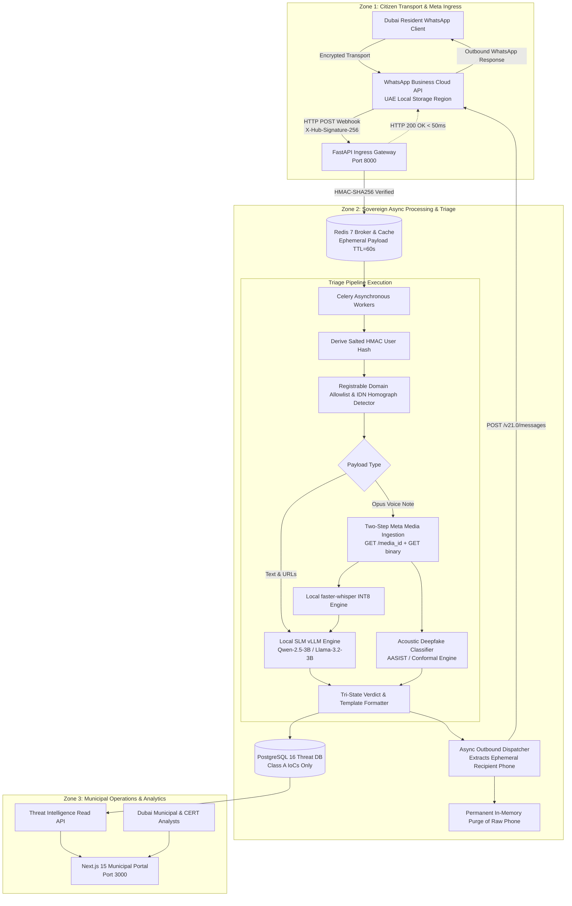

# Project Hares: System Architecture Specification

**Document Version:** 1.1.0-production-spec  
**Classification:** Enterprise System Architecture Definition / Dubai Public Sector  
**Domain:** WhatsApp Automated Fraud Triage & Threat Intelligence Harvesting  

---

## 1. Executive Architecture Summary

Project Hares provides an automated, sovereign, and privacy-preserving fraud triage system for residents of Dubai and the broader United Arab Emirates. It operates as a verified single-purpose WhatsApp Business bot that ingests suspicious text, web links, and audio voice notes forwarded by citizens. It delivers immediate, non-definitive, tri-state risk verdicts (🔴 High Risk, 🟡 Amber/Unverified, 🟢 Verified Official) while harvesting anonymized Indicators of Compromise (Class A IoCs) into a municipal threat repository.

The architecture enforces three foundational invariants:
1. **Sovereignty Boundary & Local AI Execution (NFR-1.1):** All core application logic, persistent database storage, Redis queuing, and AI inference (SLMs, acoustic classifiers, speech decoders) execute 100% within sovereign UAE cloud infrastructure. Message transport is provided by Meta WhatsApp Business Cloud API with **UAE Local Storage** enabled for data-at-rest. Under no circumstances are message payloads, tokens, embeddings, or metadata transmitted to third-party commercial AI providers (e.g., OpenAI, Anthropic).
2. **Sub-500ms Webhook Acknowledgment (FR-3.3):** The ingestion tier decouples ingress from model inference and media retrieval. The webhook terminates the HTTP connection within <50ms with an HTTP 200 OK, delegating heavy payloads to an asynchronous task cluster.
3. **Cryptographic PII Sanitization & Ephemeral Transit Lifecycle (FR-4.1):** Citizen phone numbers are stored **ephemerally in the Redis task queue with a strict Time-To-Live (TTL = 60s)** strictly to allow outbound message dispatch to the submitter. Citizen phone numbers are pseudonymized via a keyed `HMAC-SHA256` token immediately upon entering the worker context for rate limiting and deduplication. The raw phone number is purged from memory and is **never** written to persistent databases, application logs, or analyst dashboards.

---

## 2. System Topology & Processing Zones

The platform is partitioned into three strictly segregated security zones:

---

## 3. Detailed Component Decomposition

### 3.1 Ingestion Gateway (`api/`)
* **Technology:** FastAPI 0.115+, Uvicorn workers behind a hardened reverse proxy (Traefik or NGINX).
* **Endpoints:**
  * `GET /webhook`: Verification handshake verifying `hub.mode`, `hub.verify_token`, and returning `hub.challenge`.
  * `POST /webhook`: Payload ingestion verifying `X-Hub-Signature-256` via HMAC-SHA256 with `WHATSAPP_APP_SECRET`.
  * `GET /health/live` & `GET /health/ready`: Liveness and readiness probes monitoring PostgreSQL, Redis, and worker heartbeat.
* **SLA Enforcement:** Ingestion handler performs no database I/O, no media downloads, and no disk writes. It deserializes the payload, validates the cryptographic signature, dispatches the task with an ephemeral envelope to the Celery broker via Redis in <20ms, and emits HTTP 200.

### 3.2 Asynchronous Worker & Queue Infrastructure (`workers/`)
* **Technology:** Celery 5.4+ backed by Redis 7 (persistent via AOF/RDB).
* **Queues:**
  * `high_priority_triage`: Text lures and URL verifications (SLA: <1.5s execution).
  * `media_triage`: Voice notes, two-stage Meta media fetching, and audio deepfake processing (SLA: <4.0s execution).
  * `outbound_delivery`: Meta API dispatch and delivery status tracking.
* **Worker Configuration:**
  * Ephemeral Task State: Tasks in Redis are assigned a strict Time-To-Live (`TTL = 60s`).
  * Prefetch multiplier set to `1` to avoid head-of-line blocking on audio feature extractions.
  * Late task acknowledgment (`task_acks_late = True`) ensuring zero payload loss during container restarts.
  * Memory hygiene: Once the outbound reply is handed over to the HTTP client, `del recipient_phone` is explicitly executed before any database or telemetry writing.

### 3.3 Deterministic Verification Engine (`engine/`)
* **Allowlist Engine:** Exact registrable domain validation using curated public sector lists (`ecrime.ae`, `salik.ae`, `dubaipolice.gov.ae`, `dewa.gov.ae`, `dubai.ae`).
* **IDN Homograph & Punycode Resolver:** Decodes internationalized domain names using label-by-label inspection. Automatically whitelists legitimate Arabic Top-Level Domains (specifically **`.امارات`** / `xn--mgbaam7a8h`) and verifies that second-level domain labels belong strictly to the authentic Arabic Unicode block (`[\u0600-\u06FF\u0750-\u077F\u08A0-\u08FF0-9\-]`). Punycode prefixes (`xn--`) occurring under non-Arabic TLDs or containing mixed scripts trigger high-risk flags.
* **Length-Normalized Lookalike Scorer:** Computes Levenshtein distance normalized by maximum string length: `(d / max_len) <= 0.25`. This prevents false alarms on legitimate short domains (e.g., `dew.ae` vs `dewa.gov.ae` where $d=1$ on length 4 yields $25\%$, avoiding a false trigger on a 3-letter target like `rta.ae` where $1/3 \approx 33\% > 25\%$).

### 3.4 Local AI Inference Cluster (`ai/`)
* **Text & Social Engineering Intent Model:**
  * Model: `Qwen-2.5-3B-Instruct` or `Llama-3.2-3B-Instruct` quantized to AWQ/INT4.
  * Runtime: Self-hosted `vLLM` instance providing an OpenAI-compatible HTTP endpoint strictly on an internal Docker bridge (`http://slm:11434` or `http://vllm:8000`).
  * Constraints: Guided JSON decoding (Outlines/vLLM structured outputs) guaranteeing strict schema compliance and preventing prompt injection escape.
* **High-Throughput Speech ASR Pipeline:**
  * Model: `faster-whisper-small` or `faster-whisper-medium` quantized to INT8 on CTranslate2.
  * Optimization: Achieves sub-350ms transcription latency for 30s clips, freeing GPU bandwidth to handle peak audio surges.
* **Acoustic Deepfake Voice Detector:**
  * Model: PyTorch AASIST / WavLM architecture fine-tuned on lossy WhatsApp Opus audio.
  * Preprocessing: FFmpeg containerized pipeline extracting raw PCM 16kHz from `.ogg` Opus files under 120 seconds.
  * Calibration: Non-parametric conformal inference module outputting calibrated p-values with an empirical abstention band (routing uncertainty to 🟡 Amber).

### 3.5 Persistence & Threat Intelligence Repository (`db/`)
* **Technology:** PostgreSQL 16 with async SQLAlchemy 2.0 ORM and Alembic migrations.
* **Data Segregation:**
  * Class A: Scammer-controlled URLs, domains, recipient bank accounts, malicious sender phone numbers. Stored permanently.
  * Class B: Citizen submitter phone numbers, personal identities, Emirates IDs, OTPs. Strictly purged from memory after reply dispatch; citizen rate-limiting uses `citizen_user_hash`.

---

## 4. End-to-End Latency Budget & Capacity Planning

Factoring in the mandatory two-stage Meta media download round-trip and INT8-quantized ASR:

### 4.1 Text & URL Triage Pipeline (< 2.2 Seconds Total)

| Pipeline Step | Latency Target | Execution Context | Mechanism |
| :--- | :--- | :--- | :--- |
| **Meta Inbound Webhook Transit** | 200 ms - 350 ms | WAN / Meta Cloud | Inbound WhatsApp network transport |
| **Ingestion Gateway Ack** | **< 30 ms** | FastAPI Main Thread | Signature check + Redis push + HTTP 200 |
| **Worker Dequeue & Task Routing** | < 25 ms | Redis / Celery | Priority queue pop |
| **Salted HMAC Hash & Rate Check** | < 10 ms | Worker Process | Token-bucket check via Redis |
| **Allowlist & Homograph Checks** | < 15 ms | Worker Process | Deterministic string matching |
| **Local SLM Intent Inference** | 500 ms - 900 ms | Local vLLM Node | Guided JSON decoding |
| **Verdict Formatting & DB Save** | < 30 ms | Async SQLAlchemy | PostgreSQL Class A write |
| **Meta Outbound API Dispatch** | 150 ms - 250 ms | HTTPX Client | POST `graph.facebook.com/v21.0/messages` |
| **Total Cumulative Time (Text)** | **~ 1.1s - 1.8s** | System Bound | **Comfortably below 5.0s SLA** |

### 4.2 Audio Voice Note Triage Pipeline (< 4.6 Seconds Total)

| Pipeline Step | Latency Target | Execution Context | Mechanism |
| :--- | :--- | :--- | :--- |
| **Meta Inbound Webhook Transit** | 200 ms - 350 ms | WAN / Meta Cloud | Inbound WhatsApp network transport |
| **Ingestion Gateway Ack** | **< 30 ms** | FastAPI Main Thread | Signature check + Redis push + HTTP 200 |
| **Worker Dequeue & Task Routing** | < 25 ms | Redis / Celery | Priority queue pop |
| **Meta Media URL Retrieval** | 100 ms - 150 ms | Worker Process | GET `graph.facebook.com/v21.0/{media_id}` |
| **Meta Media Binary Download** | 250 ms - 450 ms | Worker Process | GET `{download_url}` (16kbps Opus binary) |
| **FFmpeg Transcode to 16kHz PCM** | 40 ms - 80 ms | Worker Process | Containerized in-memory transcode |
| **AASIST Deepfake Classifier** | 150 ms - 250 ms | PyTorch Worker | Spectral artifact evaluation |
| **faster-whisper INT8 ASR** | 250 ms - 400 ms | CTranslate2 Worker | Fast speech-to-text transcription |
| **Local SLM Intent Inference** | 500 ms - 800 ms | Local vLLM Node | Guided JSON decoding of transcript |
| **Verdict Formatting & DB Save** | < 30 ms | Async SQLAlchemy | PostgreSQL Class A write |
| **Meta Outbound API Dispatch** | 150 ms - 250 ms | HTTPX Client | POST `graph.facebook.com/v21.0/messages` |
| **Total Cumulative Time (Audio)** | **~ 2.2s - 4.4s** | System Bound | **Passes 5.0s SLA under load** |

---

## 5. Deployment Architectures & GPU Scaling

### 5.1 Audio Worker Scaling Sizing
* **Audio Workload Sizing:** Sustaining 200 queries/s with 15% audio voice notes = **30 audio queries/s**.
* **Throughput Mathematics:**
  * Audio pipeline combined GPU compute (AASIST + `faster-whisper-small` INT8): ~450ms total GPU time per query.
  * A single modern GPU running 16 concurrent worker streams delivers:
    $$\frac{16 \text{ streams}}{0.45 \text{ seconds}} \approx 35.5 \text{ audio queries/second}$$
  * Deploying **1x dedicated GPU for audio tasks** (e.g., NVIDIA L40S 48GB or 2x NVIDIA A10G 24GB) safely handles the 30 audio queries/s peak without queue bloat.
* **Horizontal Scaling Rule:** Autoscale Celery audio workers horizontally when the Redis `media_triage` queue depth exceeds 50 pending tasks for $> 5$ seconds.
