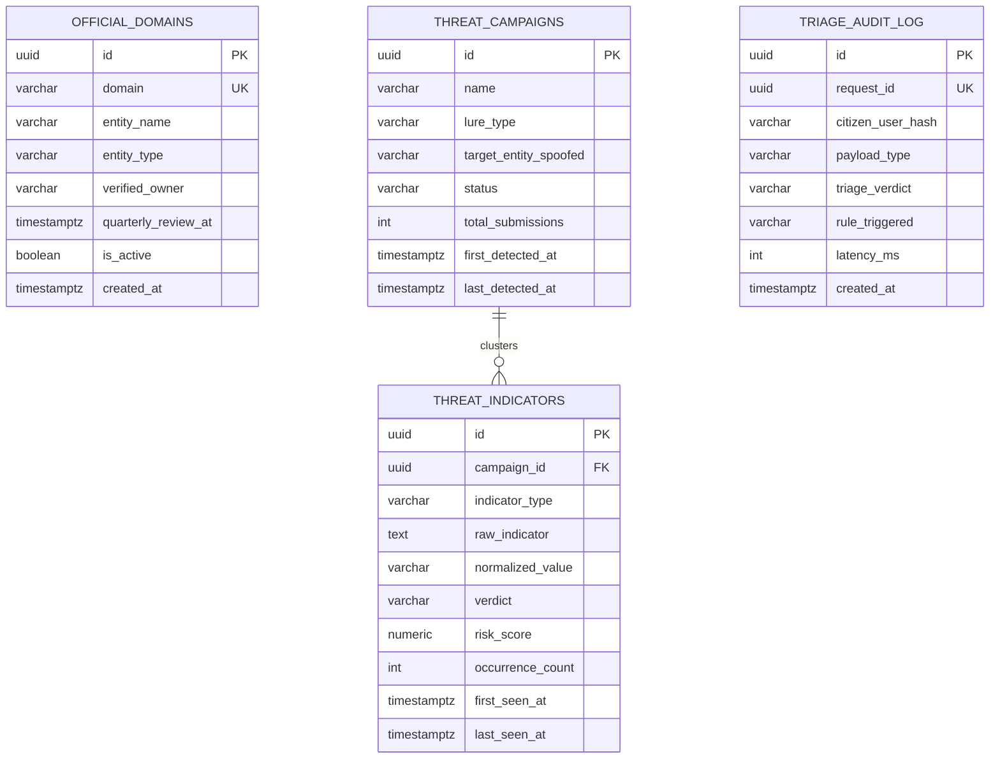

# Project Hares: Database Architecture & Data Modeling Specification

**Document Version:** 1.0.0-production-spec  
**Classification:** Database Architecture & Persistence Layer Specification  
**Technology:** PostgreSQL 16, SQLAlchemy 2.0 (Async), Alembic, Asyncpg  
**Requirements Reference:** FR-4.1 (Class A vs B Data), FR-2.2 (Allowlist), FR-4.3 (Analytics)  

---

## 1. Data Classification & Security Architecture

Project Hares enforces cryptographic isolation between threat telemetry and citizen identities prior to database insertion:

* **Class A: Scammer-Controlled Indicators (Retained Indefinitely):**
  Malicious URLs, spoofed domain names, scammer foreign phone numbers, destination cryptocurrency wallet addresses, and illicit recipient bank accounts. These represent threat intelligence and are stored in plain text for municipal SOC analysis.
* **Class B: Citizen-Specific Identifiers (Sanitized / Discarded):**
  Citizen submitter phone numbers, personal names, Emirates IDs, personal account numbers, and OTPs. Submitter phone numbers are pseudonymized via `HMAC-SHA256(phone, CITIZEN_HASH_SALT)` into a 64-character hexadecimal digest (`citizen_user_hash`) before insertion into operational audit logs. Raw phone numbers are purged from memory frames and never touch the disk.



---

## 2. Table Schemas & Data Dictionary

### 2.1 Table: `official_domains` (Curated Exact Allowlist)
Stores authenticated public-sector, utility, and banking registrable domains (FR-2.2).

```sql
CREATE TABLE official_domains (
    id UUID PRIMARY KEY DEFAULT gen_random_uuid(),
    domain VARCHAR(255) NOT NULL UNIQUE,
    entity_name VARCHAR(255) NOT NULL,
    entity_type VARCHAR(50) NOT NULL, -- 'government', 'utility', 'banking', 'telecom', 'logistics'
    verified_owner VARCHAR(255) NOT NULL,
    quarterly_review_at TIMESTAMP WITH TIME ZONE NOT NULL,
    is_active BOOLEAN NOT NULL DEFAULT TRUE,
    created_at TIMESTAMP WITH TIME ZONE NOT NULL DEFAULT NOW()
);

CREATE INDEX idx_official_domains_domain ON official_domains (domain) WHERE is_active = TRUE;
```

### 2.2 Table: `threat_indicators` (Class A Indicators of Compromise)
Stores persistent scammer indicators extracted from forwarded messages (FR-4.1).

```sql
CREATE TABLE threat_indicators (
    id UUID PRIMARY KEY DEFAULT gen_random_uuid(),
    campaign_id UUID REFERENCES threat_campaigns(id) ON DELETE SET NULL,
    indicator_type VARCHAR(50) NOT NULL, -- 'url', 'domain', 'phone_number', 'crypto_wallet', 'bank_account'
    raw_indicator TEXT NOT NULL,
    normalized_value VARCHAR(512) NOT NULL,
    verdict VARCHAR(20) NOT NULL, -- 'RED', 'AMBER'
    risk_score NUMERIC(5, 4) NOT NULL,
    occurrence_count INTEGER NOT NULL DEFAULT 1,
    first_seen_at TIMESTAMP WITH TIME ZONE NOT NULL DEFAULT NOW(),
    last_seen_at TIMESTAMP WITH TIME ZONE NOT NULL DEFAULT NOW()
);

CREATE INDEX idx_threat_indicators_normalized ON threat_indicators (normalized_value);
CREATE INDEX idx_threat_indicators_type_verdict ON threat_indicators (indicator_type, verdict);
CREATE INDEX idx_threat_indicators_last_seen ON threat_indicators (last_seen_at DESC);
```

### 2.3 Table: `threat_campaigns` (Aggregated Threat Clusters)
Aggregates related lures into discrete campaign structures for municipal analysts (FR-4.3).

```sql
CREATE TABLE threat_campaigns (
    id UUID PRIMARY KEY DEFAULT gen_random_uuid(),
    name VARCHAR(255) NOT NULL,
    lure_type VARCHAR(50) NOT NULL, -- 'traffic_fine', 'courier_fee', 'banking_kyc', 'utility_freeze', 'synthetic_audio'
    target_entity_spoofed VARCHAR(255) NOT NULL, -- 'Dubai Police', 'Salik', 'DEWA', 'Emirates Post', etc.
    status VARCHAR(50) NOT NULL DEFAULT 'active', -- 'active', 'monitoring', 'disrupted'
    total_submissions INTEGER NOT NULL DEFAULT 1,
    first_detected_at TIMESTAMP WITH TIME ZONE NOT NULL DEFAULT NOW(),
    last_detected_at TIMESTAMP WITH TIME ZONE NOT NULL DEFAULT NOW()
);

CREATE INDEX idx_threat_campaigns_status ON threat_campaigns (status);
CREATE INDEX idx_threat_campaigns_lure ON threat_campaigns (lure_type);
```

### 2.4 Table: `triage_audit_log` (Sanitized Operational Telemetry)
Audit log for system performance and anti-reconnaissance tracking. Contains zero citizen PII (FR-4.1, NFR-1.3).

```sql
CREATE TABLE triage_audit_log (
    id UUID PRIMARY KEY DEFAULT gen_random_uuid(),
    request_id UUID NOT NULL UNIQUE,
    citizen_user_hash VARCHAR(64) NOT NULL, -- Keyed HMAC-SHA256 (FR-4.1)
    payload_type VARCHAR(20) NOT NULL, -- 'text', 'url', 'audio_voice_note'
    triage_verdict VARCHAR(20) NOT NULL, -- 'RED', 'AMBER', 'GREEN'
    rule_triggered VARCHAR(100) NOT NULL, -- 'allowlist_exact', 'punycode_spoof', 'slm_intent', 'deepfake_conformal'
    latency_ms INTEGER NOT NULL,
    created_at TIMESTAMP WITH TIME ZONE NOT NULL DEFAULT NOW()
);

CREATE INDEX idx_audit_log_user_hash_created ON triage_audit_log (citizen_user_hash, created_at DESC);
CREATE INDEX idx_audit_log_created_at ON triage_audit_log (created_at DESC);
```

---

## 3. SQLAlchemy 2.0 ORM Declarations (Python 3.12+)

```python
import uuid
from datetime import datetime
from decimal import Decimal
from typing import Optional
from sqlalchemy import (
    Boolean, DateTime, ForeignKey, Index, Integer, Numeric, String, Text, func
)
from sqlalchemy.dialects.postgresql import UUID
from sqlalchemy.orm import DeclarativeBase, Mapped, mapped_column, relationship

class Base(DeclarativeBase):
    pass

class OfficialDomain(Base):
    __tablename__ = "official_domains"

    id: Mapped[uuid.UUID] = mapped_column(UUID(as_uuid=True), primary_key=True, default=uuid.uuid4)
    domain: Mapped[str] = mapped_column(String(255), unique=True, nullable=False, index=True)
    entity_name: Mapped[str] = mapped_column(String(255), nullable=False)
    entity_type: Mapped[str] = mapped_column(String(50), nullable=False)
    verified_owner: Mapped[str] = mapped_column(String(255), nullable=False)
    quarterly_review_at: Mapped[datetime] = mapped_column(DateTime(timezone=True), nullable=False)
    is_active: Mapped[bool] = mapped_column(Boolean, default=True, nullable=False)
    created_at: Mapped[datetime] = mapped_column(DateTime(timezone=True), server_default=func.now(), nullable=False)

class ThreatCampaign(Base):
    __tablename__ = "threat_campaigns"

    id: Mapped[uuid.UUID] = mapped_column(UUID(as_uuid=True), primary_key=True, default=uuid.uuid4)
    name: Mapped[str] = mapped_column(String(255), nullable=False)
    lure_type: Mapped[str] = mapped_column(String(50), nullable=False, index=True)
    target_entity_spoofed: Mapped[str] = mapped_column(String(255), nullable=False)
    status: Mapped[str] = mapped_column(String(50), default="active", nullable=False, index=True)
    total_submissions: Mapped[int] = mapped_column(Integer, default=1, nullable=False)
    first_detected_at: Mapped[datetime] = mapped_column(DateTime(timezone=True), server_default=func.now(), nullable=False)
    last_detected_at: Mapped[datetime] = mapped_column(DateTime(timezone=True), server_default=func.now(), onupdate=func.now(), nullable=False)

    indicators: Mapped[list["ThreatIndicator"]] = relationship("ThreatIndicator", back_populates="campaign")

class ThreatIndicator(Base):
    __tablename__ = "threat_indicators"

    id: Mapped[uuid.UUID] = mapped_column(UUID(as_uuid=True), primary_key=True, default=uuid.uuid4)
    campaign_id: Mapped[Optional[uuid.UUID]] = mapped_column(UUID(as_uuid=True), ForeignKey("threat_campaigns.id", ondelete="SET NULL"), nullable=True)
    indicator_type: Mapped[str] = mapped_column(String(50), nullable=False)
    raw_indicator: Mapped[str] = mapped_column(Text, nullable=False)
    normalized_value: Mapped[str] = mapped_column(String(512), nullable=False, index=True)
    verdict: Mapped[str] = mapped_column(String(20), nullable=False)
    risk_score: Mapped[Decimal] = mapped_column(Numeric(5, 4), nullable=False)
    occurrence_count: Mapped[int] = mapped_column(Integer, default=1, nullable=False)
    first_seen_at: Mapped[datetime] = mapped_column(DateTime(timezone=True), server_default=func.now(), nullable=False)
    last_seen_at: Mapped[datetime] = mapped_column(DateTime(timezone=True), server_default=func.now(), onupdate=func.now(), nullable=False)

    campaign: Mapped[Optional["ThreatCampaign"]] = relationship("ThreatCampaign", back_populates="indicators")

class TriageAuditLog(Base):
    __tablename__ = "triage_audit_log"

    id: Mapped[uuid.UUID] = mapped_column(UUID(as_uuid=True), primary_key=True, default=uuid.uuid4)
    request_id: Mapped[uuid.UUID] = mapped_column(UUID(as_uuid=True), unique=True, nullable=False)
    citizen_user_hash: Mapped[str] = mapped_column(String(64), nullable=False, index=True)
    payload_type: Mapped[str] = mapped_column(String(20), nullable=False)
    triage_verdict: Mapped[str] = mapped_column(String(20), nullable=False)
    rule_triggered: Mapped[str] = mapped_column(String(100), nullable=False)
    latency_ms: Mapped[int] = mapped_column(Integer, nullable=False)
    created_at: Mapped[datetime] = mapped_column(DateTime(timezone=True), server_default=func.now(), nullable=False, index=True)
```

---

## 4. Connection Pooling, Migrations & Maintenance

* **Connection Pool Management:**
  * Asynchronous connection pooling via `asyncpg` within FastAPI (min pool size: 10, max pool size: 50, connection timeout: 10.0s).
  * Sync connection pooling via `psycopg2` within Celery workers with pre-fork recycling to avoid connection leakage.
* **Alembic Versioning Protocol:**
  * All database modifications must be managed via explicit Alembic revisions (`alembic revision --autogenerate -m "..."`). No raw DDL executions in application runtimes.
* **Partitioning & Retention:**
  * `triage_audit_log` is partitioned monthly (`RANGE (created_at)`). Records older than 90 days are archived or purged to comply with storage constraints and privacy standards.
  * `threat_indicators` (Class A) are retained permanently as historical threat intelligence.
