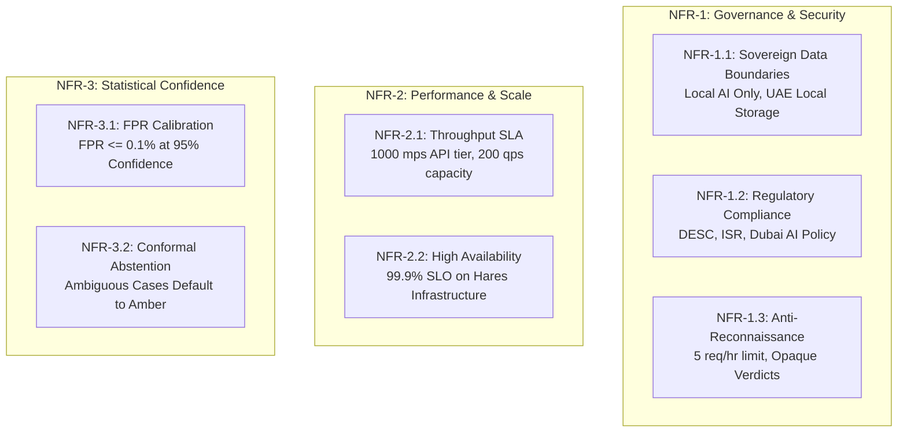

# Project Hares: System Features & Requirements Specification

**Document Version:** 1.1.0-production-spec  
**Classification:** Requirements Engineering & Feature Traceability Matrix  
**System Role:** WhatsApp Automated Fraud Triage & Threat Intelligence Pipeline  

---

## 1. Functional Requirements Matrix (FR)

### 1.1 Media Triage & Audio Deepfake Classification (FR-1.x)

| ID | Feature Name | Detailed Specification | Acceptance Criteria |
| :--- | :--- | :--- | :--- |
| **FR-1.1** | Multi-Format Audio Ingestion | Ingest forwarded voice messages and audio attachments in `.ogg` (Opus container), `.mp3`, and `.m4a` codecs received via WhatsApp Business Cloud API webhook. Perform two-step authenticated media retrieval (`GET /{media_id}` URL lookup + binary stream download). | Successful parsing and extraction of binary audio streams from Meta Cloud API endpoints into standardized in-memory audio buffers within 600ms network budget. |
| **FR-1.2** | Acoustic Artifact Evaluation | Route audio payloads to a local, self-hosted post-hoc deepfake classification model (AASIST / WavLM) to detect synthetic voice cloning, neural text-to-speech (TTS), and voice conversion (VC) artifacts. | Pipeline produces raw acoustic anomaly scores representing spectral, phase, and temporal synthesis inconsistencies. |
| **FR-1.3** | Opus Codec Calibration | Feature extractors and front-end acoustic models must be specifically calibrated and pre-trained against lossy, low-bitrate WhatsApp Opus compression (typically 16-24 kbps VBR). | Zero feature collapse or degradation when analyzing Opus-transcoded genuine versus synthetic audio compared to uncompressed PCM. |
| **FR-1.4** | Conformal Calibration | Statistical thresholds must be calibrated using non-parametric conformal p-values calculated on an in-domain genuine reference distribution. | At an empirical $\alpha = 0.1\%$ significance level, the system reliably flags synthetic media while bounding false rejections. |
| **FR-1.5** | Payload Duration Cap | Strictly enforce a maximum duration limit of **120 seconds** for processed audio notes. Payloads exceeding 120s are immediately rejected with an explanatory user notification. | Any audio file $> 120.0\text{s}$ triggers an automated rejection message before entering GPU inference queues, conserving compute capacity. |

---

### 1.2 Text Extraction & Deterministic Link Verification (FR-2.x)

| ID | Feature Name | Detailed Specification | Acceptance Criteria |
| :--- | :--- | :--- | :--- |
| **FR-2.1** | Entity Extraction Pipeline | Parse forwarded SMS messages, chat bodies, embedded URLs, foreign phone numbers, and potential financial identifiers (IBANs, crypto addresses). | Robust extraction across bilingual (Arabic and English) message strings, stripping zero-width spaces and obfuscated link delimiters. |
| **FR-2.2** | Exact Registrable Domain Allowlist | Verify extracted hyperlinks against an exact-match allowlist containing verified official UAE public-sector entities, municipal services, utilities, and financial institutions. Allowlist includes non-`.gov.ae` domains (e.g., `ecrime.ae`, `salik.ae`). | Exact match against registrable domain (e.g., `https://subdomain.ecrime.ae/report` resolves cleanly to `ecrime.ae`). |
| **FR-2.3** | IDN Homograph & Lookalike Scorer | Execute deterministic security checks including label-by-label Punycode resolution, Arabic Unicode block validation (`[\u0600-\u06FF\u0750-\u077F\u08A0-\u08FF0-9\-]`) on `.امارات` domains, and length-normalized Levenshtein distance lookalike scoring (`d/max_len <= 0.25`). Whitelist legitimate Arabic TLDs (specifically **`.امارات`** / `xn--mgbaam7a8h`). | Correctly validates official Arabic second-level domains under `.امارات` (e.g. `بلدية-دبي.امارات`), prevents short-domain false alarms (e.g. `dew.ae` vs `dewa`), and emits an immediate 🔴 High Risk flag if an unauthorized label contains `xn--` or mixed scripts. |
| **FR-2.4** | Local SLM Social Engineering Extraction | For unlisted URLs or message text lacking deterministic indicators, invoke a locally hosted Small Language Model (SLM) executing prompt-bounded intent extraction via guided JSON decoding. | Classification of deceptive pretexting, artificial urgency (e.g., "account blocked within 2 hours"), impersonation, and fraudulent payment prompts with zero prompt injection escape. |

---

### 1.3 Tri-State Verdict Semantics & Escalation Handoff (FR-3.x)

| ID | Feature Name | Detailed Specification | Acceptance Criteria |
| :--- | :--- | :--- | :--- |
| **FR-3.1** | Tri-State Verdict Classification | Classify every submission into one of three strict operational states within 5.0 seconds: 1. **🔴 HIGH RISK (Red):** Confirmed threat match, punycode spoof, or verified deepfake. 2. **🟡 UNVERIFIED / PROCEED WITH CAUTION (Amber - Default):** Submission does not match known threat signatures, but authenticity cannot be proven. 3. **🟢 VERIFIED OFFICIAL DESTINATION (Green):** Extracted links strictly resolve to an authenticated entry on the exact-domain allowlist. | Citizen receives a standardized WhatsApp reply template corresponding to the classified state. Amber serves as the default fallback for novel or ambiguous submissions. |
| **FR-3.2** | Official Police Escalation Linkage | Whenever a Red verdict is emitted, the reply must include direct, clickable links to the official Dubai Police e-Crime portal (`https://www.ecrime.ae`) and display the non-emergency contact line (`901`). | High Risk responses provide unambiguous municipal filing pathways with pre-formatted guidance. |
| **FR-3.3** | Asynchronous Webhook Decoupling | The WhatsApp webhook endpoint must return an HTTP 200 response to the Meta Cloud API within **500 ms** (target $< 50\text{ms}$) of receipt, processing media download, inference, and replies asynchronously in background Celery workers. | 99.9th percentile webhook response time $< 50\text{ms}$; zero HTTP 504 gateway timeouts; outbound assessment delivered within 5.0 seconds. |

---

### 1.4 Data Telemetry & Sanitization Engine (FR-4.x)

| ID | Feature Name | Detailed Specification | Acceptance Criteria |
| :--- | :--- | :--- | :--- |
| **FR-4.1** | Class A vs. Class B Data Segregation & Ephemeral Routing | Strictly isolate incoming data prior to persistence: - **Class A (Scammer Indicators):** Malicious URLs, sender numbers, spoofed domains, scammer bank accounts, crypto wallets (retained indefinitely). - **Class B (Citizen Identifiers):** Citizen submitter phone number, names, Emirates IDs, personal accounts, OTPs. | Submitter phone number is held ephemerally in Redis transit queue with `TTL = 60s` strictly for outbound reply routing. Submitter phone is pseudonymized via `HMAC-SHA256(phone, salt)` for rate limiting, and purged from memory before any database write or log emission. |
| **FR-4.2** | Bilingual PII Redaction Pipeline | Redaction filters benchmarked against Arabic, English, and regional dialects to guarantee citizen PII is completely stripped from text bodies before intelligence archiving. | $\ge 99.5\%$ recall on Emirates IDs, credit card numbers, OTPs, and personal phone numbers in forwarded messages. |
| **FR-4.3** | Municipal Threat Intelligence Heatmap | Internal analytics dashboard providing aggregate temporal, category, and indicator trends for municipal analysts without exposing any Class B citizen identifiers. | Dashboard displays aggregated campaign metrics, domain blocklist exports, and trending scam templates with zero citizen data leakage. |

---

## 2. Non-Functional Requirements Matrix (NFR)

### 2.1 Security, Privacy & Legal Governance (NFR-1.x)
* **NFR-1.1 (Data Sovereignty & Processing Scope):** All application logic, databases, task queues, and AI models execute strictly within physical server infrastructure located in the UAE. Zero tokens, audio snippets, or citizen metadata are dispatched to third-party commercial AI APIs. Message transport operates via Meta WhatsApp Business Cloud API with **UAE Local Storage** enabled for data-at-rest. Citizen onboarding text explicitly discloses Meta transport boundaries.
* **NFR-1.2 (Regulatory Alignment):** System architecture adheres to the Dubai Electronic Security Center (DESC) standards, the Dubai Information Security Regulation (ISR), and the Dubai AI Security Policy.
* **NFR-1.3 (Adversarial Anti-Reconnaissance Controls):**
  1. Citizen rate-limiting: Maximum 5 queries per hour per unique user hash.
  2. Opaque triage verdicts: Responses omit granular probability scores, confidence intervals, or specific feature-level weights on Green and Amber responses.
  3. Canary monitoring: Identifies adversarial clustering where sequential variants of a scam template are submitted from related user hashes.

### 2.2 Performance, Capacity & Reliability (NFR-2.x)
* **NFR-2.1 (System Throughput & Audio Worker Provisioning):** Infrastructure sized for the WhatsApp Business Cloud API 1,000 messages/second tier, supporting a sustained arrival rate of 200 queries/second (peak 1,000 concurrent queries over 5 seconds). Audio workers provisioned with high-throughput INT8 ASR models to sustain 30 audio voice notes/second.
* **NFR-2.2 (System Availability):** 99.9% Service Level Objective (SLO) scoped to Hares-controlled infrastructure (maximum 8.76 hours unscheduled downtime per year).

### 2.3 Detection Accuracy & Conformal Guarantees (NFR-3.x)
* **NFR-3.1 (False Positive Rate Bound):** Calibrated to maintain an empirical False Positive Rate (FPR) of $\le 0.1\%$, validated across a minimum of 3,000 genuine audio/text samples per language and codec with zero false alarms at 95% statistical confidence.
* **NFR-3.2 (Abstention Policy):** When statistical confidence falls below calibrated thresholds or when media suffers from bitrate degradation, the system defaults to 🟡 Amber (Unverified) rather than issuing a speculative Red or Green verdict.
