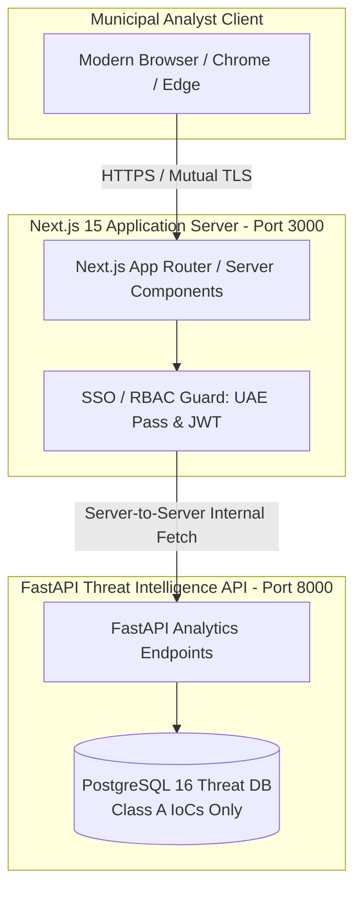

# Project Hares: Municipal Threat Intelligence Dashboard Specification

**Document Version:** 1.0.0-production-spec  
**Classification:** Frontend Application Architecture & UI/UX Specification  
**Technology Stack:** Next.js 15 (App Router), TypeScript 5.5, Tailwind CSS, Lucide Icons, Tremor / Recharts  
**Audience:** Dubai Municipal Analysts, DESC Cybersecurity Specialists, Dubai Police SOC  
**Requirements Reference:** SRS Section 2.1.2, FR-4.3 (Analytics), NFR-1.1 (Data Sovereignty)  

---

## 1. Portal Architecture & Data Sovereignty

The **Project Hares Threat Intelligence Dashboard** is an internal, authenticated operations portal deployed exclusively within secure Dubai municipal network perimeters. It provides cyber analysts with early-warning visibility into active fraud campaigns and harvested Indicators of Compromise (Class A IoCs) prior to financial loss.

> [!IMPORTANT]
> **Zero Class B Citizen PII Exposure (FR-4.3):**
> In strict compliance with privacy standards and FR-4.1, the frontend dashboard and its backing API endpoints **never** expose or display citizen submitter phone numbers, citizen names, Emirates IDs, or personal banking data. All visual telemetry reflects sanitized, aggregated threat indicators and campaign metadata.



---

## 2. Information Architecture & Navigation

The dashboard is structured into five core operational workbenches:

```
Municipal Threat Intelligence Portal/
├── 1. Overview & Heatmap (Real-Time Triage Telemetry)
├── 2. Active Campaign Tracker (Clustered Fraud Campaigns)
├── 3. IoC Repository & Export (Class A Indicators / STIX 2.1 Feed)
├── 4. Domain Spoof & Homograph Radar (Lookalike Domain Alerts)
└── 5. Synthetic Voice Note Workbench (Acoustic Spectral Analysis)
```

---

## 3. Detailed View Specifications

### 3.1 Overview & Real-Time Telemetry Heatmap (`/overview`)
* **Primary KPI Cards:**
  * *Total Scanned Messages (24h)*: Aggregate submissions processed.
  * *High Risk Verdicts (Red)*: Confirmed malicious indicators identified.
  * *Amber Unverified Fallbacks*: Submissions routed to default caution state.
  * *Average End-to-End Latency*: System turnaround time (target: $< 4.8\text{s}$).
* **Temporal Threat Curve:** Real-time multi-line chart depicting hourly submission volume disaggregated by payload type (Text, URL, Voice Note).
* **Target Impersonation Breakdown:** Donut chart illustrating distribution of spoofed UAE entities:
  * Dubai Police ($32\%$)
  * Salik Tolls ($28\%$)
  * Emirates Post ($18\%$)
  * DEWA Utilities ($12\%$)
  * Central Bank / National Banks ($10\%$)

### 3.2 Active Campaign Tracker (`/campaigns`)
* **Purpose:** Clusters high-volume distributed lures into discrete adversary operations (e.g., *"Operation Fake Fine 2026-Q4"*).
* **Campaign Data Grid:**
  * *Campaign Identifier & Codename*
  * *Lure Category* (Traffic Fine, Parcel Delivery, Utility Disconnect, Banking KYC)
  * *Targeted Entity*
  * *Current Status* (🔴 Active, 🟡 Monitoring, 🟢 Disrupted)
  * *Total Submissions Harvested*
  * *First Detected / Last Seen Timestamps*
* **Drill-Down Drawer:** Shows associated normalized URLs, lookalike domains, sender phone numbers, and linguistic templates associated with the campaign.

### 3.3 IoC Repository & Defense Feeds (`/iocs`)
* **Purpose:** Enables municipal analysts to search, filter, and export persistent Class A indicators.
* **Filter Controls:**
  * Indicator Type: URL, Domain Name, Foreign Phone Number, Crypto Wallet Address, Recipient Bank Account.
  * Risk Score: Sliders from $0.00$ to $1.00$.
  * Time Range: Last 1 hour, 24 hours, 7 days, Custom Range.
* **Automated Defense Export Protocols:**
  * **STIX 2.1 / TAXII Feed:** Structured cyber threat intelligence format for automated ingestion into municipal SIEMs (Splunk, QRadar, Microsoft Sentinel) and TDRA firewall blocks.
  * **CSV / JSON One-Click Export:** For operational forensics and law enforcement briefings.

### 3.4 Domain Spoof & Homograph Radar (`/homographs`)
* **Purpose:** Dedicated monitoring surface for lookalike domains and IDN Punycode attacks targeting official UAE registrable domains (FR-2.2, FR-2.3).
* **Lookalike Detection Table:**
  * *Spoofed Official Entity* (e.g., `ecrime.ae`)
  * *Extracted Fraudulent Domain* (e.g., `еcrіme.ae` [IDN Punycode: `xn--crm-qdd1a.ae`])
  * *Homograph Technique* (Cyrillic character substitution, hyphenation, Levenshtein distance: 1)
  * *DNS Resolution Status & Hosting IP / ASN*
  * *Action Button*: Push to National ISP Blocklist Request.

### 3.5 Synthetic Voice Note Workbench (`/audio-triage`)
* **Purpose:** Forensic inspection workspace for forwarded voice notes flagged as synthetic media (FR-1.x).
* **Forensic Spectrogram Inspector:**
  * High-resolution Mel-Spectrogram and Linear Spectral visualization.
  * Highlighting anomalous high-frequency phase inconsistencies and synthetic neural vocoder signatures.
* **Conformal Statistical Diagnostics:**
  * Raw Acoustic Score ($f(x)$)
  * Calibrated Conformal p-value ($p$-value $< 0.001$)
  * Codec Compensation Profile (WhatsApp Opus 16kbps)
  * Duration & Sampling Rate (e.g., 24.3s, 16kHz Mono)
* **ASR Transcript:** Automated Whisper transcription in Arabic/English displaying verbal pretexting cues.

---

## 4. UI/UX Aesthetics & Design Tokens

In adherence to enterprise government application standards:

* **Visual Theme:** Deep Slate Dark Mode (`#0B0F19` background, `#111827` surface cards).
* **Accent Palette:**
  * Sovereign Gold / Amber (`#F59E0B`) — System Default & Attention.
  * Critical Red (`#EF4444`) — High-Risk Threat Indicators & Malicious Infrastructure.
  * Verified Emerald (`#10B981`) — Allowlisted Municipal Domains.
  * Municipal Cyan (`#06B6D4`) — Data Stream & Telemetry Curves.
* **Typography:** Inter or Outfit for clean tabular numerics and Arabic typography support (Noto Sans Arabic).
* **Micro-Interactions:** Smooth transitions on drawer openings, pulse indicators on active streaming feeds, and clear copy-to-clipboard actions for Indicators of Compromise.

---

## 5. Security & Access Control

* **Authentication Protocol:** OpenID Connect (OIDC) / SAML 2.0 integrated with municipal enterprise identity providers.
* **Role-Based Access Control (RBAC):**
  * **Viewer:** Read-only access to aggregated overview heatmaps and campaign summaries.
  * **Analyst:** Full access to IoC search, audio inspection, and STIX/CSV export pipelines.
  * **Administrator:** Authority to update `official_domains` allowlist records and manage quarterly audit schedules.
* **Session Security:** Short-lived HTTP-only, SameSite=Strict cookies with mutual TLS (mTLS) enforcement on municipal intranet gateways.
