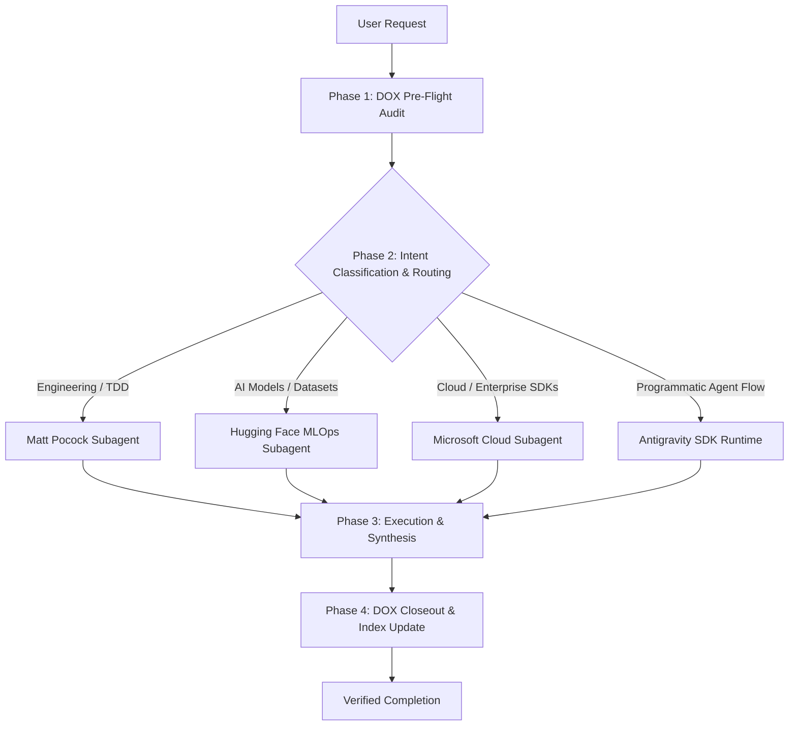

# Master Orchestrator

The Master Orchestrator serves as the supreme dispatch engine across all subagent domains within [`c:/Producttolaunch/.agents`](file:///c:/Producttolaunch/.agents). It unifies project governance, engineering execution, AI model operations, and cloud infrastructure.

---

## 1. Subagent Ecosystem & Specialization Registry

| Subagent Domain | Location | Core Responsibilities & Capabilities |
| :--- | :--- | :--- |
| **DOX Arbiter** | [`c:/Producttolaunch/.agents/dox`](file:///c:/Producttolaunch/.agents/dox) | Enforces binding `AGENTS.md` hierarchical contracts, pre-edit path traversal, doc integrity, and post-edit closeouts. |
| **Chief of Staff & Engineering Lead** | [`c:/Producttolaunch/.agents/mattpocock-skills`](file:///c:/Producttolaunch/.agents/mattpocock-skills) | System architecture (`codebase-design`, `improve-codebase-architecture`), TDD, code review, triage, and task priority orchestration (`chief-of-staff`, `grill-me`). |
| **Hugging Face MLOps Specialist** | [`c:/Producttolaunch/.agents/huggingface-skills`](file:///c:/Producttolaunch/.agents/huggingface-skills) | Model and dataset lifecycle (`huggingface-datasets`, `huggingface-spaces`, `trl-training`, `hf-cli`, `zerogpu`). Directly governs assets in [`HUGGINGFACE_CATALOG.md`](file:///c:/Producttolaunch/HUGGINGFACE_CATALOG.md). |
| **Enterprise Cloud & SDK Architect** | [`c:/Producttolaunch/.agents/microsoft-skills`](file:///c:/Producttolaunch/.agents/microsoft-skills) | Multi-SDK development (Python, TypeScript, .NET, Rust, Java), Azure cloud infrastructure, cost analysis, and Microsoft Foundry agent tools. |
| **Antigravity SDK Runtime Engine** | [`c:/Producttolaunch/.agents/antigravity-sdk-python`](file:///c:/Producttolaunch/.agents/antigravity-sdk-python) | Native Python runtime for programmatic agent leasing, streaming reasoning tokens (`response.thoughts`), intercepting tool calls, and automated subagent execution. |

---

## 2. Orchestration Lifecycle (The 4-Phase Protocol)

Every complex task routed through the Master Orchestrator executes under a strict 4-phase protocol:



### Phase 1: DOX Pre-Flight Audit
1. Read the nearest `AGENTS.md` work contract before touching any file.
2. Confirm the repository ownership, boundary invariants, and constraints.
3. Validate that no file > 100 MB is staged, and no plaintext credentials are exposed.

### Phase 2: Dynamic Intent Routing
Determine which specialized subagent holds authority over the requested task:
* **AI/ML & Hub Deployment** ➔ Route to **Hugging Face Subagent** (`huggingface-datasets`, `hf-cli`, `huggingface-spaces`).
* **Architecture, Refactoring, TDD** ➔ Route to **Matt Pocock Subagent** (`implement-spec`, `tdd`, `code-review`).
* **Cloud Infrastructure & Multi-Language SDKs** ➔ Route to **Microsoft Subagent** (`azure-skills`, `azure-sdk-python`, `azure-cost`).
* **Autonomous Scripted Execution** ➔ Route to **Antigravity SDK Runtime** (`orchestrator.py`).

### Phase 3: Execution & Synthesis
1. Execute the task adhering strictly to the selected subagent's runbook.
2. Ensure backward compatibility and cross-repository synchronization.
3. Perform dry-runs and automated verification.

### Phase 4: DOX Closeout & Verification
1. Re-check all modified files against the `AGENTS.md` hierarchy.
2. Update the nearest `AGENTS.md` if purpose, interfaces, or contracts changed.
3. Refresh all affected Child DOX indexes.

---

## 3. Invoking the Programmatic Orchestrator

For automated background orchestration, run the Python dispatcher:

```powershell
python "c:\Producttolaunch\.agents\orchestrator\orchestrator.py" --task "describe your task" --subagent auto
```

Or target a specific domain:
* `--subagent hf` (Hugging Face operations)
* `--subagent engineering` (Matt Pocock engineering workflows)
* `--subagent cloud` (Microsoft Azure & Cloud SDKs)
* `--subagent dox` (Contract auditing & doc indexing)
